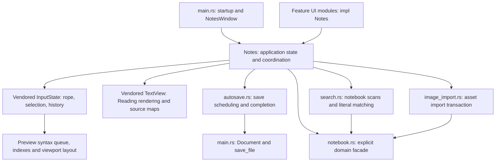

# Architecture and change guide

This maps the current implementation. The baseline review is recorded in
[the architecture audit](docs/architecture-audit.md); implementation evidence and
remaining milestones are tracked in [architecture progress](docs/architecture-progress.md).
Update this map when ownership, lifecycle rules, or verification commands change.
Read [AGENTS.md](AGENTS.md) before working, especially its vendor, commit, and
desktop-testing rules.

## System shape

GPUI Note is a desktop Markdown application with one window and one active
document or image. It uses ordinary files, a per-user notebook index, and
per-notebook JSON settings. Source and Live preview share the same editor and
undo history. Reading view is a derived rendering of that editor's current text.



These are runtime responsibilities, not enforced architectural layers. Eleven
application files contain `impl Notes`; most import the executable root with
`use super::*`. A method living in a feature file can mutate shared root state.
Follow its callers and completions before treating a file as an isolated module.

## Where responsibilities live today

| Responsibility | Starting points | Important coupling |
| --- | --- | --- |
| Startup, actions, document state, save prompts, root rendering | [main.rs](src/main.rs): `Notes`, `Next`, `request`, `continue_with`, `NotesWindow` | `NotesWindow` renders modal layers outside `Notes::render` to avoid recursively borrowing the entity. |
| Encoding and atomic note replacement | [main.rs](src/main.rs): `Document::open`, `normalize_newlines`, `save_file` | Saved text and saved rope represent the last successful write; current text belongs to `InputState`. |
| Debounced autosave and queued foreground operations | [autosave.rs](src/autosave.rs): `SaveState`, `schedule_autosave`, `start_write`; [app/operation.rs](src/app/operation.rs): `ForegroundOperation` | Background writes own a captured document baseline. Foreground prompts, navigation and saves own explicit operation tokens; queued actions carry their waiting token. |
| Notebook schema, path policy, tree values and filesystem operations | [notebook.rs](src/notebook.rs) re-exports [settings](src/notebook/settings.rs), [paths](src/notebook/paths.rs), [tree](src/notebook/tree.rs) and [storage](src/notebook/storage.rs) | Storage depends on schema/path/tree policies; policies have no UI dependencies. Existing `notebook::` entry points are preserved. |
| Notebook activation, document installation, explorer and persistence queue | [notebook_ui.rs](src/notebook_ui.rs): `NotebookState`, `activate_notebook`, `install_document`, `persist_notebooks`, `drop_entry` | Owns document replacement as well as tree presentation. |
| Sidebar visibility and width | [sidebar_ui.rs](src/sidebar_ui.rs) | Explorer and Search share sidebar geometry and visibility. |
| Preferences and settings controls | [settings_ui.rs](src/settings_ui.rs) | Applies the GPUI global theme, writes notebook settings and keeps session preferences. `can_insert_date` currently doubles as a general edit-capability check. |
| Quick open and command palette | [goto.rs](src/goto.rs): `Command`, `discover`, `ranked_entries` | Command catalogue, filesystem discovery, dispatch, focus and rendering are together. |
| Notebook search | [search.rs](src/search.rs), [search_ui.rs](src/search_ui.rs) | Worker scans use a captured unsaved rope overlay; panel owns cancellation, results and navigation state. |
| Reading find | [reading_search.rs](src/reading_search.rs) | Uses source byte ranges and `TextView::source_highlights`; hidden syntax can reveal a containing block. |
| Link editing and navigation | [links.rs](src/links.rs) | Relative note links use notebook resolution and the normal save-before-navigation path. |
| Image viewer and dropped assets | [images.rs](src/images.rs), [image_import.rs](src/image_import.rs) | Import owns rollback until insertion into the matching document snapshot succeeds. |
| Date formats and shortcuts | [templates.rs](src/templates.rs), [help_ui.rs](src/help_ui.rs) | Shortcut definitions also supply the Help listing; preserve platform modifier handling. |

## Document lifecycle and invariants

1. **Edit:** `InputState` emits `InputEvent::Change`. `Notes::subscribe_editor`
   schedules dirty comparison, autosave and notebook search; in Reading mode it
   also refreshes the derived text and find state. Features must use editor edit
   APIs that participate in change events and undo, rather than replace a second
   copy of the document.
2. **Save:** the coordinator captures document identity, path, encoding and an
   immutable rope snapshot. Background work converts and writes that snapshot.
   Success advances the saved baseline to the captured snapshot, not whatever
   happens to be in the editor at completion. Later typing must remain dirty.
3. **Navigate:** `request(Next)` serializes against an active save and runs the
   Save/Discard/Cancel decision. `continue_with` dispatches the approved action.
   Failed loads retain the current document. Cancelled pickers, failed activation,
   error dismissal and tree loads abandoned for the current note or a folder use
   `resume_document` to rearm autosave for retained text.
   Autosave debounce uses the GPUI executor timer, allowing deterministic tests.
4. **Install:** `install_document` creates a fresh editor, replaces its
   subscription, advances document identity, clears Reading find and resets the
   dirty baseline. A view-mode switch keeps the existing editor. This distinction
   prevents cross-document undo while preserving history across views.
5. **Move:** notebook moves update paths for the open buffer and persisted
   selection/expansion. Account for saves, image document paths and search state
   when changing this flow.
6. **Persist preferences:** notebook settings and the user index are separate
   atomic JSON replacements. The current task chain preserves write ordering;
   switch/close await it. Two file replacements are not one transaction.

Additional contracts to preserve:

- Original Markdown is authoritative for edits and saves. Source and Live
  preview copy source selections; Reading copies rendered selection text.
  Rendered glyphs are projections, including hidden syntax, checkboxes, tables,
  fences and images.
- Source ranges use UTF-8 byte offsets; display geometry and IME UTF-16 offsets
  are different coordinate systems. Name conversions and validate boundaries.
- A changed document edit after Undo abandons the old redo branch. Selection
  changes and identical-text replacements preserve redo. Generic component
  History has separate semantics; the editor applies its policy explicitly.
- Background results need an identity/revision or cancellation check before
  applying. Inspect each subsystem's actual check; they are not interchangeable.
- Foreground operations acquire a token from the session's persistent
  `ForegroundOperation` gate. Only a matching completion releases that token;
  stale and duplicate completions cannot install content or unlock another
  operation. Background autosave owns no foreground token. Successful writes
  advance a matching document's saved baseline even when their navigation
  continuation is obsolete. A queued save/navigation releases its waiting token
  before dispatching the next operation. Tree arrows may retarget the current
  load without acquiring another token.
- Acquiring foreground ownership must notify the view so rendered controls and
  the editor apply their disabled state. In particular, clean close disables
  input while awaiting settings persistence; it cannot accept a new unsaved edit
  after the close decision. `notebook_ui::close_tests` exercises the registered
  close callback, delayed persistence, ordinary text input and final removal.
- Live-preview parsing maintains one running job and one latest pending
  snapshot. Safe offset edits can rebase some results; context-changing edits
  invalidate them. Fenced-code tokens require their stricter revision checks.
- Preserve BOM and newline conventions; mixed endings normalize to the first
  observed convention. Failed replacement must leave the original file intact.
- Notebook-relative paths pass through the notebook path helpers. Preserve
  rejection of traversal, reserved internal paths and filesystem links. These
  checks do not establish protection against every concurrent filesystem race.
- Corrupt or unsupported settings are reported and preserved. Retain legacy
  migration and each preference's scope: autosave uses session settings for an
  open file outside the active notebook; appearance, date and sidebar preferences
  use the active notebook whenever one exists, otherwise session settings. Do
  not accidentally unify these different policies during extraction.
- Notebook search intentionally preserves the result list, selection and scroll
  when opening a result. Document installation explicitly invalidates a matching
  discarded unsaved overlay, while clean navigation retains its search state.
  Query matching currently folds ASCII only; revalidation scans all occurrences
  even though notebook result collection is capped.

## Vendored editor boundary

The root Cargo patch selects `vendor/gpui-component`, based on upstream 0.5.1 at
`0f0ab35233212f8f3277028995caf0c41e13ee6c`. Its license and
[EDITOR-PATCH.md](vendor/gpui-component/EDITOR-PATCH.md) must remain. The
[file-level inventory](vendor/gpui-component/EDITOR-PATCH-INVENTORY.md) records
all patches against the verified published package and their regression entry
points. Edit this checked-in source, never Cargo's registry cache.

| Concern | Vendor files under `src/` |
| --- | --- |
| Editor buffer, selection, input and history integration | `input/state.rs`, `input/input.rs`, `input/element.rs`, `history.rs` |
| Line presentation and source/display mappings | `input/live_preview.rs`, `input/text_wrapper.rs`, `input/line_index.rs`, `input/scroll.rs` |
| Background full-document analysis and safe rebasing | `input/preview_syntax.rs`, `input/markdown_links.rs`, `input/fenced_code.rs` |
| Table model and edit transactions | `input/table.rs`, `input/table_edit.rs` |
| Image recognition and resource resolution | `markdown_images.rs` |
| Reading parsing, source maps and rendering | `text/text_view.rs`, `text/source_map.rs`, `text/` |

Keep application filesystem operations, notebook preferences and system URL
opening in the application. Editor changes should expose a narrow operation or
event for these integrations. Some diagnostic APIs are intentionally hidden or
feature-gated; they are not promises of upstream API compatibility.

Before a vendor upgrade, inventory local modified/new files against the recorded
upstream source, reconcile each patch area, then rerun its regression coverage.
Do not assume a dependency upgrade preserves the custom editor behavior.

## How to extend a feature

| Change | Trace and validate |
| --- | --- |
| Add an editor command | Start with `goto::Command` and/or `help_ui::app_shortcuts`; resolve capability and focus; call an isolated editor edit API. Verify selection direction, Unicode, one-step undo/redo and dirty/autosave events. |
| Add a preference | Add a default/migration/normalization in `notebook::Settings` or `Appearance`; implement settings controls and session fallback; verify JSON round trips and notebook switching. |
| Add Markdown presentation | Decide Source/Live/Reading behavior explicitly; preserve original ranges; extend analysis, layout and hit mapping where needed. Test delayed/stale results, Unicode, undo and viewport bounds. |
| Change opening, moving or saving | Trace `Next`, autosave pending operations and document installation together. Test success, failure, cancellation, delayed completion and retained edits. |
| Change search | Separate matching from scan lifecycle and result navigation. Verify unsaved overlays, cancellation, limits, Reading mappings and result-list retention. |

Prefer explicit imports and a named owner for new state. A new file containing
another unrestricted `impl Notes` is organizational help, but does not create a
new ownership boundary. Add abstractions where two responsibilities actually
need a contract; retain cheap rope snapshots and the current incremental paths.

## Verification without desktop interaction

From the repository root:

[`rust-toolchain.toml`](rust-toolchain.toml) pins Rust 1.98.1, rustfmt and Clippy.
The separate [validation workflow](.github/workflows/check.yml) checks the default
application and headless tests on Windows, Linux and macOS; Windows also checks
formatting and strict lint. The release/manual packaging workflow is separate.

```powershell
cargo check --locked
cargo test --locked --features editor-diagnostics
cargo fmt --check
cargo clippy --locked --all-targets --features editor-diagnostics -- -D warnings
```

`--offline` can be added when the locked dependencies are already cached.
The audit records the original pass/fail baseline. The current baseline passes
all four commands on Windows; Linux also passes the default check and headless
suite. See [architecture progress](docs/architecture-progress.md) for counts and
platform limits. GPUI tests use `TestAppContext`/TestPlatform, not native desktop
windows. Some editor tests
include vendor source files with `#[path]`; this is why root formatting/lint
checks can also report those vendor files.

The `GPUI_NOTE_BENCH`, `GPUI_NOTE_NOTEBOOK_CHECK` and `GPUI_NOTE_AUTOSAVE_CHECK`
application harnesses require a real application/window. Agents must not launch
them, even hidden. Leave physical input, native dialogs, rendered performance
benchmarks and platform UI validation to the user. Existing recorded benchmark
results in [benchmarks/README.md](benchmarks/README.md) are historical evidence,
not results of the architecture audit.
