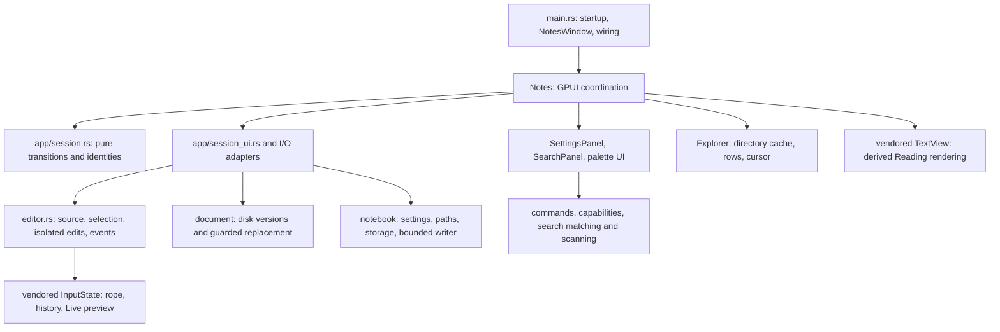

# Architecture and change guide

Start here for current ownership and extension points. Read [AGENTS.md](AGENTS.md)
for repository rules. [The dated audit](docs/architecture-audit.md) explains the
original defects and plan; [implementation progress](docs/architecture-progress.md)
records verification and platform limits. Update this map when a contract moves.

## System shape

Mithril is a single-window Markdown application with one active document,
image, or empty view. Ordinary files hold notes, a per-user index lists notebooks,
and each notebook has JSON preferences. Source and Live preview share one editor
and undo history. Reading is derived from that editor's source.



`src/lib.rs` exposes storage, domain policies, shared values and the thin GPUI
editor adapter. Pure modules do not import the application root or GPUI. The
executable owns window coordination and feature adapters. `Notes` still wires
features through `impl Notes`; moving a method to a feature file does not grant
it ownership of another feature's state. Cross-feature changes use the named
owners below, with explicit snapshots or intents at their boundaries.

## Ownership map

| Responsibility | Start here | Contract |
| --- | --- | --- |
| Startup, root rendering and action bindings | [main.rs](src/main.rs): `Notes`, `Next`, `NotesWindow` | Wire owners and dispatch actions. `NotesWindow` renders modal layers outside `Notes::render` to avoid a recursive entity borrow. |
| Content, foreground phase, writes, autosave and continuations | [app/session.rs](src/app/session.rs): `Session`; [session contract](docs/document-session.md) | Pure private state; transitions return ordered effects. No mutable content accessor or generic begin/finish bypass. |
| Session effects and captured I/O | [app/session_ui.rs](src/app/session_ui.rs), [autosave.rs](src/autosave.rs), [notebook_ui.rs](src/notebook_ui.rs) | Own prompts, task handles, captured data and operation-tagged barriers. They apply policy returned by Session. |
| Current source, selection, history and source edits | [editor.rs](src/editor.rs): `Editor` | One wrapped `InputState`, no second buffer. Features use semantic snapshot/edit/task/link/find methods. |
| Encoding and file replacement | [document/mod.rs](src/document/mod.rs), [document/storage.rs](src/document/storage.rs); [storage contract](docs/document-storage.md) | Explicit paths, captured text and opaque disk versions; receipts describe committed writes. No UI mutation. |
| Notebook schema, paths, tree values and filesystem operations | [notebook.rs](src/notebook.rs) facade; [notebook/](src/notebook) | Storage depends on schema/path/tree policies. Preserve migration and relative-path checks. |
| Preference write ordering and flush outcomes | [notebook/writer.rs](src/notebook/writer.rs): `SettingsWriter`; notebook UI driver | One running write and latest pending snapshot per destination. Index revisions depend on their book revision. |
| Active notebook, index, activation and preference scope | [notebook_ui.rs](src/notebook_ui.rs): `NotebookState`; [activation_preferences.rs](src/notebook_ui/activation_preferences.rs) | Retain canonical targets and explicit preference intents under the operation token. Never restore a stale settings clone after I/O. |
| Explorer cache, row projection and selection | [explorer.rs](src/explorer.rs): `Explorer` | Pure owner accepts settings and captured directory results. UI owns scroll/focus/workers, settings own persisted expansion and sort. |
| Settings form | [settings_ui/panel.rs](src/settings_ui/panel.rs): `SettingsPanel`; [settings_ui.rs](src/settings_ui.rs) adapter | Controls, validation and subscriptions are private. Typed preference intents cross to the adapter; dialog lifetime rejects stale events. |
| Commands and palette | [commands/mod.rs](src/commands/mod.rs), [capabilities.rs](src/capabilities.rs), [goto.rs](src/goto.rs) | Catalogue, discovery and `PaletteModel` own policy. The adapter owns input, focus and rendering and computes fresh capabilities before execution. |
| Notebook search | [search.rs](src/search.rs), [search_ui/panel.rs](src/search_ui/panel.rs), [search_ui.rs](src/search_ui.rs) | Pure matching/scanning; panel owns query, cancellation, results and navigation proposals. App supplies current overlay and approves navigation. |
| Sidebar geometry and Reading find | [sidebar_ui.rs](src/sidebar_ui.rs), [reading_search.rs](src/reading_search.rs) | Search and Explorer share geometry. Reading find maps UTF-8 source ranges into the exact rendered snapshot. |
| Links, file drops and image assets | [links.rs](src/links.rs), [images.rs](src/images.rs), [image_import.rs](src/image_import.rs) | Routing uses normal session navigation. File drops link ordinary files in place using note-relative Markdown destinations and import supported images as embeds. An image import retains rollback until insertion into its captured document/source succeeds. |
| Date values and shortcut documentation | [templates.rs](src/templates.rs), [help_ui.rs](src/help_ui.rs) | Shortcut definitions also supply Help. Preserve platform modifier handling. |

## Lifecycle rules

The complete transition/effect rules are in the [session contract](docs/document-session.md).
These are the invariants most likely to matter when changing a feature:

1. **Edit:** `Editor` forwards Change and OpenLink events. Change schedules the
   dirty-display comparison, autosave and search; Reading updates its derived
   source. `Session::edit_notice` does not compare or copy the whole source on
   every keystroke. Actual save/navigation decisions compare an immutable rope
   with the saved baseline, so Undo can make a document clean again.
2. **Save:** capture document/write identities, path, format, disk version and
   one rope. Success accepts that captured baseline exactly once, even if newer
   edits exist or an old navigation continuation has gone away. Newer text stays
   dirty. Disk conflicts retain editor/history and pause automatic retries until
   successful explicit Save or fresh installation. Ordinary failures do not loop.
3. **Navigate:** request an action through Session. It owns waiting for an active
   write, Save/Discard/Cancel, dispatch and picker/load phases. Stale completions
   cannot release newer ownership. Retained-content exits rearm eligible autosave;
   error presentation must not recursively schedule another timer over the model's
   returned ArmAutosave effect. The runtime also rejects stale timer tickets.
4. **Install:** accepted installation replaces the editor and its subscription,
   advances content identity, resets dirty-display work and Reading find, and
   notifies search. Switching view modes preserves the editor and undo history.
   Exactly one of Empty, Document or Image is active.
5. **Move:** keep the content identity and current buffer/history; remap the
   actual moved path and current settings after completion. Revalidate saved
   bytes before accepting the new disk identity. Failed revalidation keeps the
   new path but pauses automatic saving. A path-sensitive callback needs its captured path
   guard in addition to DocumentId, since moves can preserve both that ID and source.
6. **Activate/close:** activation flushes the canonical target's preferences
   before loading it. Close drains all pending destinations and refreshes its
   requirements for late edits. Retry, Cancel and explicit preference discard
   are distinct model outcomes; discard permits failed jobs, never abandoned
   pending jobs. StateChanged must disable editor input while close is waiting.

Preference scope is intentional. Appearance, date and sidebar choices use the
active notebook whenever one exists, otherwise session defaults. Autosave for a
standalone file outside that notebook uses session settings. Same-book reloads
replay only explicit mode, width and notebook-autosave choices made during the
operation, including unchanged re-selection; untouched loaded settings survive.
Removing an inactive notebook is an index edit and does not navigate or save the
active document.

Mithril stores each notebook's preferences in `.mithril/settings.json` and the
per-user notebook index under the platform configuration directory's `mithril`
folder. The explorer, search and path guards exclude `.mithril`. Earlier storage
directory names are not automatically migrated; preserve settings by renaming
those directories before opening existing notebooks with Mithril.

## Snapshot and coordinate rules

- Markdown source is authoritative. Source/Live copy source selections; Reading
  copies rendered selection text. Glyphs, hidden syntax, checkboxes and images
  are projections, not a second editable document.
- Edit and search ranges use **UTF-8 source bytes**. IME uses UTF-16 and layout
  uses display coordinates. Name conversions and validate character boundaries.
  Date/link/task edits must preserve Change events and isolated undo behavior.
- A real edit after Undo abandons the old redo branch. Selection changes and
  identical-text replacements preserve redo. Generic component History has a
  separate policy; keep the editor-specific rule at the editor boundary.
- Background work needs its owner's exact identity, snapshot or cancellation
  check. DocumentId, operation tokens, directory generations and search query
  cancellation have different meanings; none substitutes for all the others.
- `Explorer` persists across notebook changes. Clear advances its generation.
  Refresh retains visible rows/selection and completed caches, but invalidates
  obsolete Loading markers so reopening a folder can request a current worker.
- Search scans capture an unsaved rope overlay. Installation updates that overlay
  even during clean navigation; explicit discarded-document signals invalidate
  stale dirty overlays. Opening a result preserves results, selection and scroll.
  Navigation proposals are approved in order and cannot outlive their query.
  Matching folds ASCII only; revalidation scans all occurrences despite result caps.
- File writes preserve BOM/newline conventions, reject missing/link/conflicting
  targets and preserve Unix mode bits. They are optimistic guarded replacements,
  not filesystem compare-and-swap or a complete crash-durability guarantee. See
  the storage contract for race and metadata limits.

## Editor and analysis boundary

Production features use `Editor` rather than updating `InputState` directly.
Its snapshot is cheap and immutable; it does not own document identity, saved
text or another view mode. `diagnostic_input` is an explicitly documented escape
hatch for TestPlatform and opt-in diagnostic harnesses, available so ordinary
binary tests can compile without requiring a diagnostics feature. Do not use it
for production feature edits. Form/search-query inputs are separate controls and
are not document editors.

All platforms retain their native title bars and window controls.
`Notes::window_title` supplies the native title, including the unsaved marker.
On Windows, keep `TitlebarOptions::appears_transparent` false: the custom title
bar introduced in `c2ab535` was rolled back after reported close failures and
hangs. TestPlatform covers the close barrier, but cannot validate Windows
non-client hit testing, control clicks or native dragging.

The Cargo patch selects checked-in `vendor/gpui-component`, based on upstream
0.5.1 at `0f0ab35233212f8f3277028995caf0c41e13ee6c`. Preserve its license,
[EDITOR-PATCH.md](vendor/gpui-component/EDITOR-PATCH.md) and
[file-level inventory](vendor/gpui-component/EDITOR-PATCH-INVENTORY.md). Never
edit Cargo's registry cache. Before upgrading, reconcile each recorded patch
against upstream and rerun its associated regression coverage.

| Vendor concern | Starting points under `vendor/gpui-component/src/` |
| --- | --- |
| Buffer, selection, input and history | `input/state.rs`, `input/input.rs`, `input/element.rs`, `history.rs` |
| Live presentation and source/display mapping | `input/live_preview.rs`, `input/text_wrapper.rs`, `input/line_index.rs`, `input/scroll.rs` |
| Background analysis, rebasing and work bounds | `input/preview_syntax.rs`, `input/markdown_links.rs`, `input/fenced_code.rs` |
| Table edit transactions and image recognition | `input/table.rs`, `input/table_edit.rs`, `markdown_images.rs` |
| Reading parsing and source maps | `text/text_view.rs`, `text/source_map.rs`, `text/` |

Live analysis keeps one running job and one latest pending snapshot. A queued
mixed request converts its rope once and borrows one worker-local GFM tree for
link/table/code/image visitors. Plain-text fast paths and independent incremental
parsers remain. Safe offset edits can rebase results; context changes invalidate
them, and fenced-code tokens have stricter revision checks.

Reading also keeps one running parse and one latest source/type request,
including initial layout. Generations reject stale successes and errors.
Presentation props update without reparsing, retained trees keep their own
source for callbacks, and find waits for the exact tree snapshot. Preserve its
ListState across updates. These changes reduce parser and queued work; headless
tests do not establish native frame latency.

## How to extend a feature

| Change | Entry point and focused verification |
| --- | --- |
| Add a command | Add identity/metadata in `commands/catalogue.rs`, capability policy if needed and dispatch in `goto.rs`. Add shortcut/Help bindings when appropriate. Test catalogue/ranking and actual editor transaction behavior. |
| Add a preference | Define default/migration in `notebook/settings.rs`; add a typed SettingsPanel value/intent and apply its intended scope in the adapter. Test invalid values, scope, stale dialog events and JSON round trips. |
| Change opening/saving/close | Add a named Session transition/effect and pure stale/failure/cancel tests. Use TestPlatform when prompts, timers, buffers or preference barriers matter. Read the storage contract before changing writes. |
| Change the explorer | Change `Explorer` policy and its tests; keep filesystem workers and GPUI scroll/focus in the adapter. Test delayed refresh, selection by path and notebook switches. |
| Change search | Keep scan policy, panel lifecycle and app navigation distinct. Test captured overlays, cancellation, delayed results, navigation ordering and Reading mappings. |
| Extend Markdown behavior | State Source/Live/Reading semantics and coordinate conversions. Test Unicode, source preservation, one-step undo, stale parses and viewport/queue work bounds. Update the vendor inventory when appropriate. |

Prefer explicit imports, named input values and one authoritative state owner.
Introduce abstractions for real ownership/testing boundaries, not a trait per
function or a maximum file-length rule. Keep capability snapshots fresh and use
semantic edit/save/search queries instead of repurposing a command's predicate.

## Verification without desktop interaction

Application branding is owned by [`assets/brand/README.md`](assets/brand/README.md)
and [`scripts/build-icons.mjs`](scripts/build-icons.mjs), generated from the
marketing site's exact SVG mark. `build.rs` embeds Windows icon resource 1;
release packaging includes the macOS ICNS and Linux PNG/desktop entry. Linux's
launcher identity matches `WindowOptions::app_id` (`org.mithril.Mithril`).
Windows also uses the embedded icon in its native title bar.

Windows distribution is owned by
[`packaging/windows/mithril.iss`](packaging/windows/mithril.iss) and the
[`build.yml`](.github/workflows/build.yml) release workflow. The installer owns
only app binaries, shortcuts and its per-user uninstall registration; notebook
files and preferences remain application/user-owned. Keep its AppId stable for
upgrades. Stable `vMAJOR.MINOR.PATCH` tag pushes build and test Windows x86-64
using the pinned Rust toolchain; the tag must match Cargo metadata. Manual runs
retain Actions artifacts without publishing. The separate publish job uses
`MITHRIL_RELEASES_TOKEN` only in its publishing step to write Release assets to
`travisluong/mithril-releases`; the built-in token stays read-only in all jobs.
[`release.mjs`](.github/scripts/release.mjs) owns tag/version validation,
checksums and draft publication. It downloads and verifies assets before making
a draft public, resumes matching drafts, and leaves published releases unchanged.
The public tag targets that repository's `main`; source identity lives in the
release notes. No source or binaries are copied into public Git history.
See the [packaging guide](packaging/windows/README.md) for setup, compiler
verification and manual installation checks; agents must not run the installer
or application to validate desktop behavior.

[Rust 1.98.1](rust-toolchain.toml) is pinned. The separate
[validation workflow](.github/workflows/check.yml) checks Windows, Linux and
macOS; Windows also enforces format and strict lint. Packaging is separate.

```powershell
cargo check --locked
cargo test --locked --features editor-diagnostics
cargo fmt --check
cargo clippy --locked --all-targets --features editor-diagnostics -- -D warnings
```

Add `--offline` when locked dependencies are cached. Use focused filters while
editing, then run the integrated gates. Relevant suites include `app::session`,
`notebook_ui`, `settings_ui`, `search_ui`, library `commands`/`explorer`/`editor`,
public document/settings-writer tests, and editor/history/transaction/Reading
integration tests. Some tests include vendor source through `#[path]`, so root
format/lint checks can report those files.

GPUI tests use TestPlatform, not native desktop windows. Agents must not launch
`MITHRIL_BENCH`, `MITHRIL_NOTEBOOK_CHECK`, `MITHRIL_AUTOSAVE_CHECK` or other
native application harnesses, even hidden. Leave physical input, native pickers,
rendered benchmarks and platform UI validation to the user. Historical results
in [benchmarks/README.md](benchmarks/README.md) are not current verification.
Current test counts, platform execution and remaining limits belong in
[implementation progress](docs/architecture-progress.md).

Logical line movement is a semantic Editor operation. The vendored editor owns the source transaction and selection remapping; document-only shortcuts and palette capabilities exclude Reading and form inputs.


Inline-code ranges are derived by the shared preview worker. TextWrapper invalidates them on edits and accepts exact revisions; mapped presentation and background painting retain UTF-8 source coordinates.


List item ranges share preview analysis and are valid only for their exact revision. InputState owns pending marker presses and drag state; list_reorder owns source transforms. Checkbox toggles happen on release unless dragging starts; successful drops emit one normal isolated editor edit.


Sidebar context menus live in `notebook_ui/entry_menu.rs`; each target captures
notebook root, explorer generation and relative path. File operations live in
`notebook/entry_ops.rs`, with link/name guards and collision-safe duplication.
Rename uses the existing move owner. Session owns approved `EntryOperation`
lifetimes, write barriers and deletion/installation outcomes. OS Trash is isolated
behind the storage adapter and replaced with a fixture backend in UI tests.
