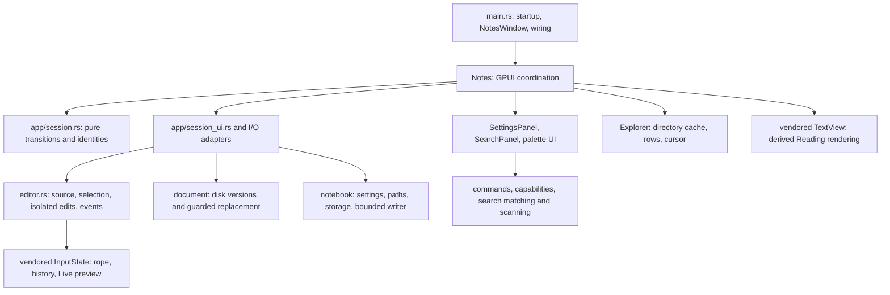

# Architecture and change guide

Start here for current ownership and extension points. Read [AGENTS.md](AGENTS.md)
for repository rules. [The dated audit](docs/architecture-audit.md) explains the
original defects and plan; [implementation progress](docs/architecture-progress.md)
records verification and platform limits. Update this map when a contract moves.

## System shape

Mithril is a single-window Markdown application with retained document tabs.
Each tab owns a document view, image, or empty view; canonical notes share a document runtime. Ordinary files hold notes, a per-user index lists notebooks,
and each notebook has JSON preferences. Source and Live preview share document text and undo history across views. Reading is derived from that editor's source.



`src/lib.rs` exposes storage, domain policies, shared values and the thin GPUI
editor adapter. Pure modules do not import the application root or GPUI. The
executable owns window coordination and feature adapters. `Notes` still wires
features through `impl Notes`; moving a method to a feature file does not grant
it ownership of another feature's state. Cross-feature changes use the named
owners below, with explicit snapshots or intents at their boundaries.

## Ownership map

| Responsibility | Start here | Contract |
| --- | --- | --- |
| Startup, root rendering and action bindings | [main.rs](src/main.rs): `Notes`, `Next`, `NotesWindow` | Wire owners and dispatch actions. `NotesWindow` renders modal layers outside `Notes::render` to avoid a recursive entity borrow. |
| Shared documents | [shared_documents.rs](src/shared_documents.rs): `DocumentRuntime` | Canonical registry owns stable document identity, buffer subscription, shared baseline, save policy/timer/error and dirty comparison. Tabs retain independent views. |
| Retained tabs and workspace close/move/delete coordination | [tabs.rs](src/tabs.rs): `TabSet`, `Tab`, `WorkspaceOperation` | Stable TabId qualifies session-local identities. Tab selection retains all document runtime state; preparation retains buffers until every required decision and I/O succeeds. |
| Content, foreground phase, writes, autosave and continuations | [app/session.rs](src/app/session.rs): `Session`; [session contract](docs/document-session.md) | Pure private state; transitions return ordered effects. No mutable content accessor or generic begin/finish bypass. |
| Session effects and captured I/O | [app/session_ui.rs](src/app/session_ui.rs), [autosave.rs](src/autosave.rs), [notebook_ui.rs](src/notebook_ui.rs) | Own prompts, task handles, captured data and operation-tagged barriers. They apply policy returned by Session. |
| Current source, selection, history and source edits | [editor.rs](src/editor.rs): `Editor` | One `InputState` view over shared `InputBuffer`; view-local layout and selection are projections of its rope. Features use semantic snapshot/edit/task/link/find methods. |
| Encoding and file replacement | [document/mod.rs](src/document/mod.rs), [document/storage.rs](src/document/storage.rs); [storage contract](docs/document-storage.md) | Explicit paths, captured text and opaque disk versions; receipts describe committed writes. No UI mutation. |
| Notebook schema, paths, tree values and filesystem operations | [notebook.rs](src/notebook.rs) facade; [notebook/](src/notebook) | Storage depends on schema/path/tree policies. Preserve migration and relative-path checks. |
| Preference write ordering and flush outcomes | [notebook/writer.rs](src/notebook/writer.rs): `SettingsWriter`; notebook UI driver | One running write and latest pending snapshot per destination. Index revisions depend on their book revision. |
| Active notebook, index, activation and preference scope | [notebook_ui.rs](src/notebook_ui.rs): `NotebookState`; [activation_preferences.rs](src/notebook_ui/activation_preferences.rs) | Retain canonical targets and explicit preference intents under the operation token. Never restore a stale settings clone after I/O. |
| Explorer cache, row projection and selection | [explorer.rs](src/explorer.rs): `Explorer` | Pure owner accepts settings and captured directory results. UI owns scroll/focus/workers, settings own persisted expansion and sort. |
| Settings form | [settings_ui/panel.rs](src/settings_ui/panel.rs): `SettingsPanel`; [settings_ui.rs](src/settings_ui.rs) adapter | Controls, validation and subscriptions are private. Typed preference intents cross to the adapter; dialog lifetime, form identity and preference scope reject stale events. |
| Commands and palette | [commands/mod.rs](src/commands/mod.rs), [capabilities.rs](src/capabilities.rs), [goto.rs](src/goto.rs) | Catalogue, discovery and `PaletteModel` own policy. The adapter owns input, focus and rendering and computes fresh capabilities before execution. |
| Notebook search | [search.rs](src/search.rs), [search_ui/panel.rs](src/search_ui/panel.rs), [search_ui.rs](src/search_ui.rs) | Pure matching/scanning; panel owns query, cancellation, results and navigation proposals. App supplies all retained document overlays and approves navigation. |
| Workspace geometry, right panel and Reading find | [sidebar_ui.rs](src/sidebar_ui.rs), [right_panel_ui.rs](src/right_panel_ui.rs), [reading_search.rs](src/reading_search.rs) | Search and Explorer share the left panel. The workspace fits independently resizable side panels around at least 200 logical pixels of content. Notebook settings own persisted sidebar/terminal widths; Notes owns session-only right-panel visibility and the terminal width fallback without a notebook; TerminalTabs owns retained session identities and cleanup tasks, TerminalSession owns each view, and the terminal runtime owns PTY processes. Reading find maps UTF-8 source ranges into the exact rendered snapshot. |
| Window title/menu bar | [title_bar_ui.rs](src/title_bar_ui.rs), [Edit menu](src/title_bar_ui/edit.rs); [Windows commands](src/title_bar_ui/windows.rs) | Platform frame presentation, measured menu overflow, popup anchors and optional sidebar/terminal panel buttons. Windows caption handlers post native move/minimize/maximize/restore commands after GPUI input returns; custom close shares the native close lifecycle. Menus reuse existing command owners. Root owns the Linux resize border. |
| Workspace toolbars | [toolbar_ui.rs](src/toolbar_ui.rs) | Sidebar controls belong above Explorer/Search; content controls belong above tabs. When an active notebook sidebar is collapsed, its enabled toolbar button moves to the fixed left edge before navigation; reopening restores its fixed sidebar position. The opener follows workspace toolbar visibility and sizing. Toolbar icons and Settings rows cannot be reordered. A shared effective item list drives region visibility, widths and rendering. The terminal opener sits at the right edge of the editor toolbar while collapsed; the terminal header owns its always-available collapse button. Both use the existing retained-session toggle action. Fixed regions use the built-in item order and read effective visibility/sizing from the settings adapter. Dispatches navigation to existing owners. Toolbar, palette and document shortcuts share `apply_markdown_format`, which checks edit capability and modal state before the semantic Editor boundary; heading menus additionally retain document/source/selection guards. Owns no panel state or preferences. |
| Links, file drops and image assets | [links.rs](src/links.rs), [images.rs](src/images.rs), [image_import.rs](src/image_import.rs) | Routing uses normal session navigation. File drops link ordinary files in place using note-relative Markdown destinations and import supported images as embeds. An image import retains rollback until insertion into its captured document/source succeeds. |
| Date values and shortcut documentation | [templates.rs](src/templates.rs), [help_ui.rs](src/help_ui.rs) | Shortcut definitions also supply Help. Preserve platform modifier handling. |

The Settings dialog builder owns its SettingsPanel and a lifetime token. Notes
retains weak handles, a subscription and captured preference scope. Settings is
rendered in the modal layer by NotesWindow, over the retained document content;
dismissal restores the prior focus. Closing through Root also expires authority
before a stale form can affect another dialog. The title and section navigation
remain fixed while the body scrolls; narrow dialogs use a horizontal section row.
Reopening an active modal preserves its section and input drafts. Document guards
and the modal overlay pause tabs, navigation, commands, search and file drops.
Search retains its query/results; autosave and preference persistence continue.
Settings uses 80% of the window content width and height, clamped to 24-pixel
margins. Its size stays fixed across sections and follows window resizing;
unmoved dialogs recenter, while dragged positions are retained where possible.
DialogPlacement exposes opt-in margins and preferred-size updates; other dialogs
retain the default 16-pixel margin and existing fixed-size behavior.

The shared palette dialog in `goto.rs` uses `Dialog::overlay_color` with a transparent
backdrop for Commands, Go To, Change Notebook and Sort Files. Opening these palettes
preserves the workspace colors while retaining modal input blocking, outside-click
dismissal and focus restoration. Other dialogs retain the theme's overlay color.
`PaletteModel` wraps Up/Down selection within the current filtered results for all
four palettes; the adapter scrolls the selected row into view and retains query focus.

Navigation history is a pure, session-only owner in `app/navigation.rs`, held by
each Tab. The session adapter proposes a revision-tagged history visit through Next;
only accepted document/image installation commits its cursor. Ordinary installs
record canonical paths, and accepted Empty installation clears the history.
Sidebar-created notes use the same hook; successful moves remap visited paths.
Back/Forward share `navigate_history` from the toolbar, palette, View menu and
Alt+Left/Right (Windows/Linux) or Cmd+Option+Left/Right (macOS). The capability
snapshot derives both targets from the active tab without requiring a notebook
or document. Execution recomputes the target and rechecks busy/dialog state.
Known image visits remain available after switching notebooks, with path/link
validation on traversal. Failed, cancelled and stale loads leave history intact.

Document tabs have a horizontally scrollable strip above content, with New tab and
close controls. File menu, palette and Mod+T/Mod+W share the existing tab owners.
New note uses the guarded notebook adapter and Next::NewNote for the active root,
available from File, palette and Mod+N. New tab creates an empty session without
a disk file. Explorer,
links, search, Go to File, picker and history navigation install in the current
tab, attaching to retained in-memory text when the canonical note is already open.
TabSet retains document tabs in groups keyed by canonical notebook root, plus a
standalone group. Each group owns order, selected TabId and tab-strip scrolling;
all groups share window-wide tab identities and global document/save lookup.
Tabs, including empty tabs and external files, stay in the group where created.
The tab strip and select/close controls only expose the active group; global
iteration still includes hidden views for saves, close prompts and move/delete.
Successful notebook activation restores an existing group's views without loading
its last file or replacing editors. First activation loads one saved last file or
an empty tab. Failed or stale activation leaves the previous group intact.
Removing an index entry retains its group; removing the active notebook switches
to the standalone group without discarding drafts. Reopening restores that group.
Tabs remain session-only; startup still restores only the saved last file.
Selecting or creating an empty tab, including one left active after closing a tab,
clears the active notebook's persisted last file. Startup restores that notebook
with one empty tab; selecting a notebook document records it for startup again.

`shared_documents.rs` owns one runtime per canonical note. A stable document ID
qualifies dirty work, timers and write callbacks independently of any view's TabId.
Document baseline metadata is shared, and Session's private SavePolicy holds one
write/debounce/retry authority. Each tab keeps its own foreground continuation;
one accepted write receipt updates the baseline and releases only matching waiting
views. Background results never select tabs or steal focus. Any foreground phase
or workspace operation blocks tab changes; background writes permit switching.

The vendored InputBuffer owns shared text/history and weak view registrations.
InputState retains selection, scrolling, find and layout; source edits synchronously
update peer snapshots and remap selections and viewport anchors. Its buffer event
subscription lives in DocumentRuntime, surviving the departure of the editing view.
Source/Live/Reading modes and navigation history remain per tab. Switching views
breaks typing groups; Undo/Redo from either view uses the common document history.
View menu actions, direct palette entries and Mod+Shift+M mode cycling share the
guarded `change_view_mode` adapter. It rejects busy/modal interaction before
`set_mode`, which retains notebook preference scope and activation replay rules.
The cycle follows Source, Live preview, Reading, then Source.

Leaving or closing one view retains the document without prompting while another
view remains. Last-view exits use the usual Save/Discard/Cancel transitions.
Workspace close, moves and Trash pause autosave and prepare distinct documents in
first-tab order, retaining every view until the operation succeeds. Window close
then uses the preference-flush barrier. Moves remap all views/histories and reindex
the registry, revalidating each document baseline once; Trash clears every affected
view only after filesystem success. Failed writes, moves, deletion or cancelled
preparation preserve all buffers and resume eligible timers. Search captures one
shared source overlay per document, retaining it until the last view leaves.

Canonical loaded notebooks are cached at application level. Each tab retains its
owning notebook's autosave scope (the longest containing loaded root); preference
changes persist that notebook and reschedule its tabs even when another sidebar
notebook is active. Effective autosave for files outside the current notebook is
controlled independently by the active notebook's `Settings::autosave_external_files`
flag, which defaults to false for new and existing notebooks. Without an active
notebook it uses a session-only flag, also off by default. This uses the same path
membership rule as the External file badge, including retained tabs from another
notebook and files opened without a notebook. Delays retain their owning notebook
or session scope. General Settings exposes this separate switch and identifies
the scope of the ordinary notebook controls; appearance, sidebar and toolbar
preferences continue to use the active notebook.

Appearance also owns the centered-editor toggle and maximum pane width (default
700 logical pixels, bounded to 200–4000). Settings General edits these through
typed intents and the existing appearance scope/write guards. View → Centered
editor exposes the same preference as a checked toggle, rechecking modal/busy
guards before updating appearance and retaining the saved width; standalone use
keeps session defaults. Notes passes a content-width constraint to the vendored
Input and TextView: their text columns center within the available area beside
the sidebar, while their scroll viewports and scrollbar tracks retain full width.
The configured width includes existing horizontal padding. Reading applies
padding inside its virtualized rows and invalidates cached row heights on column
changes while retaining its logical scroll anchor. Input keeps its search panel
and wheel target at full width. Layout changes retain editor identity, selection
and shared undo history; tabs, toolbars, images and empty views keep their layout.

## Lifecycle rules

The complete transition/effect rules are in the [session contract](docs/document-session.md).
These are the invariants most likely to matter when changing a feature:

1. **Edit:** `Editor` forwards Change and OpenLink events. Change schedules the
   dirty-display comparison, autosave and search; Reading updates its derived
   source. `Session::edit_notice` does not compare or copy the whole source on
   every keystroke. Actual save/navigation decisions compare an immutable rope
   with the saved baseline, so Undo can make a document clean again.
2. **Save:** capture document/write identities, path, format, disk version and
   one rope. Success accepts that captured baseline exactly once, even if newer
   edits exist or an old navigation continuation has gone away. Newer text stays
   dirty. Disk conflicts retain editor/history and pause automatic retries until
   successful explicit Save or fresh installation. Ordinary failures do not loop.
3. **Navigate:** request an action through Session. It owns waiting for an active
   write, Save/Discard/Cancel, dispatch and picker/load phases. Stale completions
   cannot release newer ownership. Retained-content exits rearm eligible autosave;
   error presentation must not recursively schedule another timer over the model's
   returned ArmAutosave effect. The runtime also rejects stale timer tickets.
4. **Install:** accepted installation replaces the editor view and link subscription,
   binds its content identity to the retained or newly loaded document runtime,
   resets view-local Reading find and notifies search. Switching view modes preserves the editor and undo history.
   Exactly one of Empty, Document or Image is active.
5. **Move:** keep the content identity and current buffer/history; remap the
   actual moved path and current settings after completion. Revalidate saved
   bytes before accepting the new disk identity. Failed revalidation keeps the
   new path but pauses automatic saving. A path-sensitive callback needs its captured path
   guard in addition to DocumentId, since moves can preserve both that ID and source.
6. **Activate/close:** activation flushes the canonical target's preferences
   before loading it. Close drains all pending destinations and refreshes its
   requirements for late edits. Retry, Cancel and explicit preference discard
   are distinct model outcomes; discard permits failed jobs, never abandoned
   pending jobs. StateChanged must disable editor input while close is waiting.

Preference scope is intentional. Appearance, date, sidebar/terminal widths and toolbar choices use the
active notebook whenever one exists, otherwise session defaults. Autosave for a
standalone file outside that notebook uses the active notebook's external-file enable flag and session delay (both session-only when no notebook is open). Same-book reloads
replay only explicit mode, width and notebook-autosave choices made during the
operation, including unchanged re-selection; untouched loaded settings survive.
Removing an inactive notebook is an index edit and does not navigate or save the
active document.

Mithril stores each notebook's preferences in `.mithril/settings.json` and the
per-user notebook index under the platform configuration directory's `mithril`
folder. The explorer, search and path guards exclude `.mithril`. Earlier storage
directory names are not automatically migrated; preserve settings by renaming
those directories before opening existing notebooks with Mithril.

Notebook discovery exclusions belong to `notebook/exclusions.rs`. Settings store
`excluded_patterns` per notebook; `NotebookState` compiles an immutable policy on
activation and preference changes. Explorer directory reads, notebook search and
Go to File capture that policy, matching slash-separated relative paths and their
folder ancestors. Changes invalidate explorer generations and restart search;
explicit opening, links, last-file restoration and document saves retain their
existing access rules. Invalid external regexes preserve the stored list and
disable the custom policy with a notice so Settings can repair it.

## Snapshot and coordinate rules

- Markdown source is authoritative. Source/Live copy source selections; Reading
  copies rendered selection text. Glyphs, hidden syntax, checkboxes and images
  are projections, not a second editable document.
- Edit and search ranges use **UTF-8 source bytes**. IME uses UTF-16 and layout
  uses display coordinates. Name conversions and validate character boundaries.
  Date/link/task edits must preserve Change events and isolated undo behavior.
- A real edit after Undo abandons the old redo branch. Selection changes and
  identical-text replacements preserve redo. Generic component History has a
  separate policy; keep the editor-specific rule at the editor boundary.
- Background work needs its owner's exact identity, snapshot or cancellation
  check. DocumentId, operation tokens, directory generations and search query
  cancellation have different meanings; none substitutes for all the others.
- `Explorer` persists across notebook changes. Clear advances its generation.
  Refresh retains visible rows/selection and completed caches, but invalidates
  obsolete Loading markers so reopening a folder can request a current worker.
- Search scans capture all open documents' rope overlays within the notebook root.
  Installation updates those overlays even during clean navigation; explicit discarded-document signals invalidate
  stale dirty overlays. Opening a result preserves results, selection and scroll.
  Navigation proposals are approved in order and cannot outlive their query.
  Matching folds ASCII only; revalidation scans all occurrences despite result caps.
- File writes preserve BOM/newline conventions, reject missing/link/conflicting
  targets and preserve Unix mode bits. They are optimistic guarded replacements,
  not filesystem compare-and-swap or a complete crash-durability guarantee. See
  the storage contract for race and metadata limits.

## Editor and analysis boundary

Production features use `Editor` rather than updating `InputState` directly.
Its snapshot is cheap and immutable; it does not own document identity, saved
text or another view mode. `diagnostic_input` is an explicitly documented escape
hatch for TestPlatform and opt-in diagnostic harnesses, available so ordinary
binary tests can compile without requiring a diagnostics feature. Do not use it
for production feature edits. Form/search-query inputs are separate controls and
are not document editors.

`title_bar_ui.rs` owns the combined title/menu bar: sidebar toggle, six menus
(File, Edit, View, Search, Notebooks and Help),
measured trailing-menu overflow, popup anchors, and platform control/drag regions.
Windows/macOS request transparent title bars; macOS retains native traffic lights.
Linux requests client decorations, using Root's existing WindowBorder, and falls
back to menus below a native title bar if the compositor keeps server decorations.
The sidebar icon before File reuses the guarded sidebar adapter and stays available
in every header mode. Fullscreen retains the toggle and menus without controls or
drag space. Toolbar and tabs
remain below the bar. `Notes::window_title` still updates the OS title and unsaved
marker; tabs display filenames without unsaved-change indicators.

Only empty title-bar space can initiate dragging. Windows caption controls have
individual non-client hit-test regions and leave press/release events unhandled
for GPUI. Linux close and the native should-close callback share
`Notes::request_window_close`, preserving workspace save/discard/cancel and
preference-flush barriers. No custom control directly removes the window.
The earlier component TitleBar was rolled back after reported close failures and
hangs; this application-owned bar does not reuse its ancestor drag handlers.
Headless tests verify menus, geometry and close barriers, but cannot prove native
control clicks, snapping or dragging, or resolution of the previously reported hang.

The Cargo patch selects checked-in `vendor/gpui-component`, based on upstream
0.5.1 at `0f0ab35233212f8f3277028995caf0c41e13ee6c`. Preserve its license,
[EDITOR-PATCH.md](vendor/gpui-component/EDITOR-PATCH.md) and
[file-level inventory](vendor/gpui-component/EDITOR-PATCH-INVENTORY.md). Never
edit Cargo's registry cache. Before upgrading, reconcile each recorded patch
against upstream and rerun its associated regression coverage.

| Vendor concern | Starting points under `vendor/gpui-component/src/` |
| --- | --- |
| Buffer, selection, input and history | `input/state.rs`, `input/input.rs`, `input/element.rs`, `history.rs` |
| Live presentation and source/display mapping | `input/live_preview.rs`, `input/text_wrapper.rs`, `input/line_index.rs`, `input/scroll.rs` |
| Background analysis, rebasing and work bounds | `input/preview_syntax.rs`, `input/markdown_links.rs`, `input/fenced_code.rs` |
| Table edit transactions and image recognition | `input/table.rs`, `input/table_edit.rs`, `markdown_images.rs` |
| Reading parsing and source maps | `text/text_view.rs`, `text/source_map.rs`, `text/` |

Live analysis keeps one running job and one latest pending snapshot. A queued
mixed request converts its rope once and borrows one worker-local GFM tree for
link/table/code/image visitors. Plain-text fast paths and independent incremental
parsers remain. Safe offset edits can rebase results; context changes invalidate
them, and fenced-code tokens have stricter revision checks. Unchanged links keep
their mapped presentation during pending context analysis; overlapping edits retire
only affected links. Link queries translate across edits and compact their bounded
offset log after 64 edits without copying or parsing document source. Exact
analysis remains authoritative for changed Markdown context. Live links reveal
individually when the caret touches their source range, including boundaries;
other links remain rendered even on the active line or in the active table cell.
A direct click emits OpenLink without moving the caret or editing the document.
Tables retain byte-identical, source-mapped projections during pending context
analysis, including unchanged tables inside a list-move replacement. TableIndex
rebases their ranges without GFM work on the input thread; only the exact worker
snapshot can validate changed Markdown context. Edited table structures retire
individually, preserving unrelated tables and their width/scroll caches.

Reading also keeps one running parse and one latest source/type request,
including initial layout. Generations reject stale successes and errors.
Presentation props update without reparsing, retained trees keep their own
source for callbacks, and find waits for the exact tree snapshot. Preserve its
ListState across updates. These changes reduce parser and queued work; headless
tests do not establish native frame latency.

## How to extend a feature

| Change | Entry point and focused verification |
| --- | --- |
| Add a command | Add identity/metadata in `commands/catalogue.rs`, capability policy if needed and dispatch in `goto.rs`. Add shortcut/Help bindings when appropriate. Test catalogue/ranking and actual editor transaction behavior. |
| Add a preference | Define default/migration in `notebook/settings.rs`; add a typed SettingsPanel value/intent and apply its intended scope in the adapter. Test invalid values, scope, stale dialog events and JSON round trips. |
| Change opening/saving/close | Add a named Session transition/effect and pure stale/failure/cancel tests. Use TestPlatform when prompts, timers, buffers or preference barriers matter. Read the storage contract before changing writes. |
| Change the explorer | Change `Explorer` policy and its tests; keep filesystem workers and GPUI scroll/focus in the adapter. Test delayed refresh, selection by path and notebook switches. |
| Change search | Keep scan policy, panel lifecycle and app navigation distinct. Test captured overlays, cancellation, delayed results, navigation ordering and Reading mappings. |
| Extend Markdown behavior | State Source/Live/Reading semantics and coordinate conversions. Test Unicode, source preservation, one-step undo, stale parses and viewport/queue work bounds. Update the vendor inventory when appropriate. |

Prefer explicit imports, named input values and one authoritative state owner.
Introduce abstractions for real ownership/testing boundaries, not a trait per
function or a maximum file-length rule. Keep capability snapshots fresh and use
semantic edit/save/search queries instead of repurposing a command's predicate.

## Verification without desktop interaction

Application branding is owned by [`assets/brand/README.md`](assets/brand/README.md)
and [`scripts/build-icons.mjs`](scripts/build-icons.mjs), generated from the
marketing site's exact SVG mark. `build.rs` embeds Windows icon resource 1;
release packaging includes the macOS ICNS and Linux PNG/desktop entry. Linux's
launcher identity matches `WindowOptions::app_id` (`org.mithril.Mithril`).
The title bar owns the sidebar button before the menus. Settings → Toolbar → Top
bar controls `toolbar.title_bar_sidebar` and `toolbar.title_bar_terminal` (both
default false), independently of workspace toolbar visibility and icon sizing.
The existing `toolbar.terminal` preference controls the editor
toolbar opener in Content right. The sidebar toolbar button defaults to enabled.
Explicit saved choices are preserved; reset applies the new defaults. The optional
top-bar terminal button sits before caption controls and toggles the retained
panel. Native shell icons continue to use the packaged brand resources.

Windows distribution is owned by
[`packaging/windows/mithril.iss`](packaging/windows/mithril.iss) and the
[`build.yml`](.github/workflows/build.yml) release workflow. The installer owns
only app binaries, shortcuts and its per-user uninstall registration; notebook
files and preferences remain application/user-owned. Keep its AppId stable for
upgrades. Stable `vMAJOR.MINOR.PATCH` tag pushes build and test Windows x86-64
using the pinned Rust toolchain; the tag must match Cargo metadata. Manual runs
retain Actions artifacts without publishing. The separate publish job uses
`MITHRIL_RELEASES_TOKEN` only in its publishing step to write Release assets to
`travisluong/mithril-releases`; the built-in token stays read-only in all jobs.
[`release.mjs`](.github/scripts/release.mjs) owns tag/version validation,
checksums and draft publication. It downloads and verifies assets before making
a draft public, resumes matching drafts, and leaves published releases unchanged.
The public tag targets that repository's `main`; source identity lives in the
release notes. No source or binaries are copied into public Git history.
See the [packaging guide](packaging/windows/README.md) for setup, compiler
verification and manual installation checks; agents must not run the installer
or application to validate desktop behavior.

[Rust 1.98.1](rust-toolchain.toml) is pinned. The separate
[validation workflow](.github/workflows/check.yml) checks Windows, Linux and
macOS; Windows also enforces format and strict lint. Packaging is separate.

```powershell
cargo check --locked
cargo test --locked --features editor-diagnostics
cargo fmt --check
cargo clippy --locked --all-targets --features editor-diagnostics -- -D warnings
```

Add `--offline` when locked dependencies are cached. Use focused filters while
editing, then run the integrated gates. Relevant suites include `app::session`,
`notebook_ui`, `settings_ui`, `search_ui`, library `commands`/`explorer`/`editor`,
public document/settings-writer tests, and editor/history/transaction/Reading
integration tests. Some tests include vendor source through `#[path]`, so root
format/lint checks can report those files.

GPUI tests use TestPlatform, not native desktop windows. Agents must not launch
`MITHRIL_BENCH`, `MITHRIL_NOTEBOOK_CHECK`, `MITHRIL_AUTOSAVE_CHECK` or other
native application harnesses, even hidden. Leave physical input, native pickers,
rendered benchmarks and platform UI validation to the user. Historical results
in [benchmarks/README.md](benchmarks/README.md) are not current verification.
Current test counts, platform execution and remaining limits belong in
[implementation progress](docs/architecture-progress.md).

Logical line movement is a semantic Editor operation. The vendored editor owns the source transaction and selection remapping; document-only shortcuts and palette capabilities exclude Reading and form inputs.
Ordered line moves normalize affected sibling lists with the original list start
through list_edit, including selection offsets and continuation indentation.
The swap and normalization share one isolated history entry in Source and Live.

Inline-code ranges are derived by the shared preview worker. TextWrapper invalidates them on edits and accepts exact revisions; mapped presentation and background painting retain UTF-8 source coordinates.

List item ranges share preview analysis and are valid only for their exact revision. InputState owns pending marker presses and drag state; list_reorder owns source transforms. Checkbox toggles happen on release unless dragging starts; successful drops emit one normal isolated editor edit.

Sidebar context menus live in `notebook_ui/entry_menu.rs`; each target captures
notebook root, explorer generation and relative path. File operations live in
`notebook/entry_ops.rs`, with link/name guards and collision-safe duplication.
Rename uses the existing move owner. Session owns approved `EntryOperation`
lifetimes, write barriers and deletion/installation outcomes. OS Trash is isolated
behind the storage adapter and replaced with a fixture backend in UI tests.
On Windows, the adapter runs Trash on a dedicated thread so its STA COM setup
never runs on GPUI's MTA worker pool. Thread creation failures, shell errors and
backend panics return through the normal failed-entry path, preserving content.

Live-preview fenced blocks reserve the full wrapped geometry of both fence lines.
Selection changes hide or reveal fence glyphs only; font, padding, source mapping,
background and downstream positions stay fixed. Outer fence rows own rounded
corners. `tests/code_highlighting.rs` covers caret/selection movement, themes,
long info strings, empty/unfinished/nested blocks, Unicode, CRLF and history.
Windows sidebar Reveal is owned by `notebook_ui/reveal.rs`. It launches Explorer
with the validated target and normalizes only shell-facing verbatim drive/UNC
spellings, preserving native path characters. Async failures update the notice
only while the captured notebook/generation remains current. Tests inject an
in-memory backend; other platforms keep GPUI's reveal integration.

View > Sort files and the window toolbar sort button share `Notes::file_sort_menu` in
`sidebar_ui.rs`. The command palette's Sort picker also uses `FileSort::OPTIONS`,
marks/selects the active order, and dispatches through `set_file_sort` for Explorer
updates and persistence. The picker captures the notebook root across dismissal;
a different or removed active notebook rejects the preference change. Explorer
refresh generations do not invalidate a same-notebook preference choice. Escape
returns to commands. Palette and View theme toggles share the guarded
`toggle_theme` adapter in `settings_ui.rs`, preserving notebook/session scope and
working without a document. Neither port owns new preference state.

View > Hide toolbars toggles `ToolbarSettings::visible` through the settings adapter,
persisting per active notebook or using session defaults without a notebook.
Visibility defaults to true for new and existing settings. Hiding removes both toolbar rows
and borders without changing item preferences; resetting toolbar defaults restores
visibility. The toggle follows the existing busy/modal guards.

The toolbar sidebar button defaults on; explicit saved visibility is retained.
Resetting toolbar defaults turns that item on again.
The workspace toolbars use `ToolbarSettings` in `notebook/settings.rs` for independent
sidebar, Explorer, Search and Sort visibility plus eleven Markdown formatting
controls (bold, italic, strikethrough, heading, inline code, code block, link,
blockquote, ordered list, unordered list and task list), all enabled by default.
SettingsPanel's
Toolbar tab emits typed item intents; the settings adapter applies them immediately
to the active notebook through SettingsWriter, or to session defaults without a
notebook. Missing settings and missing item fields preserve enabled defaults.
Both the settings list and workspace toolbars use the fixed 18-item
ToolbarItem::DEFAULT_ORDER, grouped by region. Workspace toolbars also filter by
visibility; hidden items return to their built-in positions when enabled.
Legacy toolbar.order values are ignored
on load and omitted on subsequent saves; loading alone does not rewrite settings.
No order preference, move intent, drag handle, preview or insertion target remains.
Disabling all items in a toolbar removes its row and border.
Heading and Sort retain the vendored dropdown/popover completed-click trigger;
other popovers retain mouse-down activation. Headless toolbar interaction tests
cover fixed ordering, absence of drag operations, disabled commands, focus,
persistence and Settings synchronization.
The workspace starts directly below the menu bar. The sidebar toolbar contains
Sidebar, Explorer, Search and Sort by default.
Content has fixed left navigation, centered formatting and a right Terminal action,
above the retained tab strip. Equal side reservations center formatting within the
content column. Its measured width selects one row or a top navigation/action row
followed by centered wrapping formatting rows. Document errors and notebook notices
are inside the workspace content column. Sidebar collapse removes its toolbar;
content controls remain available with no notebook. Settings groups items by region.
Legacy `alignment` values still deserialize and round-trip but no longer affect
presentation; there is no alignment control or mutation intent.
The default-enabled terminal opener lives at the right edge of the editor toolbar
while collapsed, following workspace toolbar visibility and icon sizing. Opening
hides that button and shows a matching collapse button at the right edge of the
terminal header, outside the scrolling tabs. It toggles a full-height right panel
containing retained terminal tabs. Notes retains
open/closed state for the window session (initially closed). Sidebar and terminal
widths persist per notebook through SettingsWriter and its close-time flush.
Terminal width defaults to 280 px for older notebooks; without an active notebook,
it uses a separate session-only width. Notebook activation restores both widths
and replays only explicit choices scoped to that operation. Opening focuses the active
terminal; closing restores active content focus. Modal/busy guards apply to both
the editor opener and terminal collapse button. Hiding toolbars or disabling the
opener leaves the terminal collapse button and existing toggle commands available.
The terminal header matches one workspace toolbar row: 33/41/49 logical pixels
for Small/Medium/Large, including 4 px padding per side and a 1 px bottom border.
Its collapse button shares toolbar icon/target sizing. The header stays one row tall
when content controls wrap, independently of the theme's interface font size.
Workspace layout resets resize state when panel visibility or viewport width changes.
The sidebar normally ranges from 160 to 600 px. The terminal has a 160 px normal
minimum and no fixed maximum; proportional compression preserves
200 px of content on narrow windows. Projected widths never overwrite preferences.
The workspace opts into adjacent-only divider resizing: each divider changes
only its two neighbors and stops at either pane's limits. Only completed, current
user resize gestures save the corresponding side's preference. Widening restores
the preferred widths.
ToolbarSettings also stores typed Small, Medium and Large icon presets; missing or
invalid values default to Medium; explicitly stored Small or Large values survive.
Toolbar-tab size intents use the same notebook/session
scope, lifetime and busy guards. Reset toolbar to defaults emits one typed intent
restoring the complete order, visibility, Left alignment and Medium size together,
skipping unchanged notebook writes. The toolbar owns exact 14/20/28 px icons in
24/32/40 px button targets and wraps controls as needed; its height follows the
button rows and padding. Theme UI font size does not scale these logical-pixel targets.
The content toolbar remains visible with the sidebar collapsed or no notebook open;
sidebar actions appear only with the sidebar and retain their busy guards. Only a visible
sidebar panel is highlighted. Menu commands and shortcuts remain available.
Notebook-root file drops remain within Explorer; the toolbar is not a drop target.

Markdown formatting transformations belong to `markdown_edit.rs`, a pure UTF-8
range/text/selection interface. `Editor::format_markdown` applies a transform as
one isolated normal editor replacement, restores its selection and focuses the
editor. Source and Live share edits, Change notifications and undo/redo. Toolbar
editing is enabled for documents (including standalone files) in Source and Live,
and rechecks current capability/dialog state on invocation. Reading, empty/image
views and busy sessions reject edits. The heading menu captures editor/document
identity, source and selection; Link reuses the existing guarded link dialog.
Toolbar icons use Lucide exclusively. Official SVGs for formatting and sort in
`assets/toolbar` are embedded by `src/assets.rs`, which falls back to the existing
component's Lucide bundle for navigation and other icons. Source revision, icon
mapping, license and the rule for future additions live in `assets/toolbar/README.md`.

Theme palettes persist independent Light and Dark background, font, primary,
border, icon, and secondary RGB colors. Missing/invalid border, icon and secondary
values normalize using the containing palette's mode default. Icon defaults to
the built-in font; secondary is a rounded 12% primary / 88% background blend of
the built-in colors (Light #E4E4E4, Dark #383838). Both remain independent of
later font, primary or background edits. SettingsPanel owns six picker subscriptions
and emits typed color intents; the settings adapter applies the active palette to
shared theme colors and reset restores both complete palettes. Secondary, its
hover and active variants use the selected secondary; secondary text uses font.
The optional component Theme.icon_color and Icon::themed_color opt neutral icons
into the palette without changing labels, explicit semantic colors, disabled
inheritance or foregrounds on primary/status buttons. This covers toolbar, tabs,
menus, dialogs and selectors; Explorer/palette disclosure glyphs color only their
prefixes. Custom toolbar children receive the button's disabled state explicitly.
The top navigation, sidebar resize divider, other shared border consumers, and
current sidebar entry outline use theme.border. Shared input borders (theme.input),
including sidebar and Settings controls, inherit theme.border. Focused inputs
retain theme.ring; primary checkbox colors retain their existing role.

List drops replace the smallest changed UTF-8 span and retain a source-mapped viewport anchor through deferred preview layout. Intentional pointer, keyboard, scroll and text changes release the anchor; selection remapping after a drop does not reveal an offscreen caret.

Numeric list Enter uses input/list_edit.rs source-line container scanning and an isolated transaction shared by Source and Live. It preserves the list start and delimiter, updates only direct siblings, and adjusts continuation indentation when digit widths change. No GFM parse runs on the input thread.

Numbered items now participate in the shared revision-guarded drag index, including numeric-only documents. Item metadata retains marker extent, list identity/start and content indentation. Numeric drops accept only numeric destinations in the same quote context, move subtrees, and normalize both affected sibling lists through list_edit. Hover and press share measured number-marker bounds; numbered tasks also accept their checkbox target.

Notebook result navigation uses Editor::reveal_match to select UTF-8 source text
without taking focus. InputState owns a pending range reveal through current
wrapping and preview analysis; layout reveals the match independently of the
caret, including table scroll. Explicit editor interaction retires that target.
SearchPanel restores query focus for clicks, Enter and arrows, and restores the
previous result on cancelled/failed navigation. Successful clicks preserve list
scroll. Reading initializes its find state without focusing its input when the
navigation comes from notebook search.

Live-preview thematic breaks come from the shared worker GFM tree. TextWrapper
accepts parsed divider ranges only for the exact source revision. Edits rebase
byte-unchanged divider lines until that parse arrives; changed or joined lines
retire immediately. Mode/document resets clear them. Presentation retains
literal source shaping and mappings; LineLayout paints a 2 px theme.border rule outside the caret row,
using the available content width and measured marker indentation. Revealing
syntax changes painting only, keeping wrapped height and downstream positions
stable. Source mode and the Reading divider renderer retain their behavior.
Headless coverage lives in tests/horizontal_rules.rs and tests/editor.rs.

Live-preview link menus belong to InputState's MouseContextMenu; Reading link
menus belong to TextViewState. Both capture the painted link's parsed destination
on right-click and copy it verbatim as plain text, preserving relative paths,
fragments, source and selection. Reading includes linked images and retained
parse trees. Live uses the existing exact-layout link guard before caret movement;
Source keeps its ordinary editor menu. PopupMenu owns keyboard/pointer dismissal
and focus restoration. No link parsing or app-level navigation runs for copying.
Headless pointer/menu/clipboard coverage lives in tests/link_context_menu.rs.

Live-preview strikethrough ranges come from the shared worker GFM tree via
input/strikethrough.rs. TextWrapper accepts exact revisions and clears ranges
on edits and mode/document resets. Presentation hides tilde delimiters outside
the active row while shaped runs retain the strike, including nested formatting
and inline code. Escaped markers and code literals remain literal. Source bytes
and source/display mappings remain authoritative. Regression coverage lives in
tests/strikethrough.rs and tests/editor.rs.

Code blocks expose a top-right Copy code icon in Live preview and Reading. The
vendored code_copy control isolates pointer presses from editor/Reading selection.
Live places controls from visible opening-row geometry and copies the worker's
parsed code value only while its source revision is current; Source has no control.
Reading uses the same control by default, preserving custom code_block_actions.
Copy excludes fences and container prefixes and does not edit text or selection.
Headless pointer/clipboard coverage lives in tests/code_copy.rs.

Sidebar visibility and Explorer selection remain owned by `sidebar_ui.rs`.
Title bar, toolbar, View menu, palette and Mod+Shift+B/Mod+Shift+E share those adapters,
requiring an active notebook and rejecting busy/modal interaction. Hiding the
sidebar retains the active Search panel; reopening restores its query focus.
Show Explorer reveals the tree without discarding Search query/results. View
menu actions dispatch after dismissal so popup focus restoration cannot replace
the destination focus. Help derives both shortcuts from the binding catalogue.

Palette discovery and core file commands retain their existing feature owners.
Command rows display right-aligned Kbd badges from registered action bindings.
The help adapter maps equivalent palette commands to Notes or DocumentEditor
contexts, independent of palette input focus; commands without bindings have no
badge. Disabled commands retain badges alongside their availability explanation.
Search > Go to file and Mod+O use notebook discovery, falling back to the system
file picker without a notebook; palette Open file always uses the system picker.
View > Command palette opens the command search. Palette Save uses the document
save capability (including Reading); Manage notebooks rechecks the notebook
index's writability. All palette execution rejects active dialogs and busy state.
TestPlatform captures file-picker operations at the presentation boundary and
supplies outcomes to the production session completion adapter.

Task completion and date insertion share guarded adapters in `goto.rs`:
`Notes::toggle_selected_tasks` and `Notes::insert_current_date`. Palette commands
and focused DocumentEditor shortcuts (Mod+L and Mod+Shift+D) reuse the semantic
Editor transactions, rejecting Reading, non-document content, busy state and
active dialogs. Date insertion retains notebook/session format scope. Toggle
selected tasks creates tasks or toggles completion; Format: Task list separately
applies or removes task-list syntax. Help derives the date shortcut from bindings.

Explorer selection actions share captured EntryTarget guards in
notebook_ui/entry_menu.rs. F2 is scoped to NotebookTree and opens the existing
Rename dialog, rejecting writes and modal/busy interaction. The command palette
captures the selected file or folder at opening, displays its relative path and
retains root, generation, path and directory kind across dismissal for Copy
relative path and Reveal. Selection changes never retarget these commands;
stale notebooks/generations/rows and removed or linked paths reject execution.
The active document is never an implicit Explorer target.

## Edit menu and retained selections

The top bar includes File, Edit, View, Search, Notebooks and Help. Edit (Alt+E)
is presented by `title_bar_ui/edit.rs`: history, clipboard and selection commands
reuse component actions; Format, date, tasks and link commands reuse the guarded
command adapter in `goto.rs`. Shortcut labels use the action mapping in
`help_ui.rs`. Source/Live entries target the remembered document selection.
Menu callbacks capture document/editor identity, mode, source and selection,
recheck busy/modal and edit capability, then execute after popup dismissal so
nested menus cannot steal focus from the editor or a newly opened dialog.
Reading keeps Copy available for rendered selections and disables editing.
TextView's opt-in `persistent_selection` retains Reading selections on outside
clicks, including opening the Edit menu; inside clicks still start a new selection.
Other TextViews retain their default outside-click selection clearing behavior.

## Mermaid diagrams

Fenced blocks labelled `mermaid` render offline in Live preview and Reading.
Source mode remains literal. The vendored `mermaid` Cargo feature is enabled by
Mithril; `src/mermaid.rs` owns the application-wide rendering queue and LRU cache.
It pins Merman 0.7.0 for native SVG generation and uses resvg 0.45.1 with all
image-resource resolvers disabled. The SVG root canvas is made transparent so
both views inherit their native themed code-block background; Merman's dark
palette alone can leave a white canvas. Diagram work runs separately from Markdown
analysis. A render key contains the parsed code, appearance, width and device
scale. Weak request tickets discard abandoned queued work and stale completions;
results never mutate document text, selection or history. One worker runs at a
time, with at most 64 pending distinct requests. The cache is limited to 64 MiB
and 256 entries; input is limited to 50,000 bytes and images to 4,000,000 pixels.

The existing AST visitors classify fences and retain source mappings. Live
projection belongs to `input/text_wrapper/mermaid.rs`: an anchor row displays
the image, covered source rows have zero display height, and any intersecting
caret/selection reveals the complete source. Geometry changes use the existing
scroll anchor compensation. Projections keep weak image references so scrolling
does not retain images beyond the shared cache. Edits, mode changes, appearance
and size changes invalidate projections before accepting another keyed result.
Reading CodeBlock keeps its source runs and requests the same renderer; an active
Find result reveals the block's source. Both modes retain Copy code and use source
plus a compact message while pending or on failure. Reading measures the actual
content width before requesting a fitted image. No notebook setting or disk
format changes are involved. `tests/mermaid.rs` exercises native rendering and
GPUI TestPlatform behavior; the existing cross-platform validation workflow runs
it with `editor-diagnostics`. See `docs/mermaid.md` for usage and compatibility.

## Settings JSON editing

General Settings offers Open settings JSON for the active notebook. The dialog
retains a pending-open flag while the notebook's preference writer drains, checking
its current flush barrier after each completion so later edits are included. Dialog
identity, lifetime, scope and busy guards still apply; failure keeps the form open.
Success dismisses the modal before normal current-tab document navigation and its
unsaved-change prompt. Without a notebook the button is disabled.

The document-loading adapter alone admits the exact `.mithril/settings.json` path,
checking the notebook root, metadata directory and regular file for links. Tree
resolution and persisted relative paths still exclude `.mithril`. JSON uses the
existing Source-only installation and shared-buffer/save contracts. Opening or
selecting this document skips last-note persistence, preserving the Markdown mode,
last note and loaded disk baseline. This adds no automatic reload of manually
edited preferences.

## Text file editing

`document::open` accepts UTF-8 text (including BOM and existing newline conventions)
without an extension allowlist; binary control data and invalid UTF-8 are rejected.
The normal captured-write, conflict, autosave and shared-buffer contracts apply to
all text files. Notebook discovery and search remain Markdown-specific.

`Tab::apply_document_mode` forces non-Markdown documents into Source at installation
and path remapping. It retains the previous Markdown mode for subsequent navigation;
forcing Source never writes the notebook's view preference. Capabilities disable
Live/Reading and Markdown formatting, tasks, links and image insertion for these
files, while normal text editing, find/replace, undo and saving remain available.
`Editor::set_document_path` selects a grammar through `editor/language.rs`; unknown
extensions use plain text. The vendored `InputState::set_document_language` changes
syntax presentation without replacing the rope, selection or history. Markdown
Source uses highlighting and Live retains its existing projection; non-Markdown
views cannot enable Live or Markdown list continuation/nesting.
The tab strip derives external-file context from each canonical file path and the
current notebook root. Files outside that root show an “External file” badge;
the tab tooltip explains “This file is outside the current notebook.” and includes
the full path. With no notebook, it says “No notebook is open.” Empty tabs have no
badge. This is current membership, not picker provenance: opening an in-notebook
file through Open keeps it an ordinary notebook file, and switching notebooks or
moving a file recomputes the indicator without persisted state.
External autosave changes travel through SettingsPanel's typed
`ExternalAutosaveEnabled` intent, retaining dialog identity/lifetime and busy-phase
autosave guards. Its scope follows the active notebook, even when the selected file
is outside that notebook or belongs to another retained notebook. NotebookState
saves the flag in that notebook's `.mithril/settings.json` through the ordinary
ordered preference writer and close-flush barrier; the per-user index no longer
stores it. An old index-wide flag is ignored rather than copied into notebooks.
Same-notebook activation replays explicit choices, including unchanged re-selection;
choices during a switch cannot change the destination notebook's setting.
`autosave.rs` distinguishes scoped editable preferences from effective per-tab
policy: the external flag overrides enabled state for external paths while the
ordinary notebook autosave preference remains separate. Toggling it reschedules all retained documents;
notebook installation also recomputes effective policy, cancelling newly external
files' pending timers when disabled. Already captured writes finish normally.
Manual Save and unsaved-change prompts retain their existing behavior.

## Right-panel terminal trial

terminal.rs owns shell resolution, bounded PTY I/O, process control and reaping;
terminal_ui.rs owns TerminalTabs (stable IDs, ordered sessions, active selection,
subscriptions, scrolling and cleanup tasks) and each retained TerminalSession view
with generation-tagged asynchronous launches. right_panel_ui.rs captures launch
settings/directory, coordinates tab selection and guards input by active identity.
The header contains compact scrollable tabs with individual close buttons
and an add button beside the strip that stays visible during overflow. Stable IDs increase for the lifetime of the window. Closing
the active tab selects the right neighbor, falling back to the left; closing the
last tab hides the panel. Opening an empty panel starts a fresh shell.
Hiding the panel retains every shell and its output; notebook/document changes
never retarget existing shells. Exited and failed tabs retain output/status.
TerminalView emits window-independent TerminalTitleChanged events for OSC 0/2
and resets while processing output. TerminalSession subscribes with identity,
view and generation guards, updating the retained tab title even while hidden.
Empty titles fall back to the shell name; titles are bounded visually with full
tooltips. Shell hooks and command inference are outside this contract.
Closing a tab invalidates pending installation and retains cleanup until late
launches have been stopped and reaped. Accepted session Close signals all live
sessions and awaits both their cleanup and already-closing tabs before removing
the window; cancelled document close preserves every terminal.

Notebook terminal.windows_shell defaults to powershell, with git_bash as
the other Windows choice; standalone settings remain session-only. The Terminal
settings section owns the shell dropdown and synchronizes its effective selection.
Settings uses
the existing form-scope guards and ordered writer. Unix uses the user's shell.
TerminalSettings also owns optional font_family and font_size overrides, exposed
only in Settings → Terminal. Missing/null overrides follow the resolved editor
monospace font and content size independently; explicit sizes clamp to 10–40 px.
Unavailable fonts retain their saved name and use the resolved editor monospace
font until available. Notes resolves installed font names before synchronizing
every retained session, including hidden tabs. TerminalSession retains the latest
complete view configuration during launch; font changes remeasure the grid and
resize the PTY without replacing its process or output. These settings use the
same notebook/session scope, guarded form intents and ordered writer as the cursor.
TerminalSettings also owns cursor_style (line by default, box or underline).
Settings emits a typed cursor preference intent; notebook persistence and standalone
session scope match shell selection. Notes synchronizes terminal appearance and
cursor style for every session, even while hidden. TerminalSession retains the
latest style during
launch so async installation cannot restore an old preference. Config updates
preserve the PTY, terminal grid and output. The vendored renderer honors application
cursor visibility while the host configuration determines the shape.
Terminal focus consumes shell keys independently of document commands; the host
retains Ctrl+backtick, and modal/busy input guards are checked at dispatch time.
TerminalView owns Alacritty selection, plain-text extraction and GPUI clipboard
operations. Its measured grid geometry is shared by hit testing and selection
painting. Host interaction authority protects copy and selection independently
of running-shell write permission, allowing copy from exited output. TerminalSession
owns the Copy/Paste popup with menu/view/generation identity and dispatch-time
active-tab, visibility, modal and busy guards. Hidden/blocked sessions discard
menus; keyboard clipboard shortcuts are consumed before shell encoding.
The terminal context unbinds Root's Tab/Shift+Tab focus actions so the guarded
raw key handler sends shell completion bytes while retaining terminal focus.
Shift+Enter has an explicit CSI-u mapping (ESC [ 13 ; 2 u) so prompt editors can
distinguish multiline input from Enter's carriage return. This does not enable
or advertise the full kitty keyboard protocol.

vendor/gpui-terminal is upstream 0.1.0 with the patches recorded in
TERMINAL-PATCH.md, selected by Cargo's patch table. Preserve its licenses and
patch log. The native view uses GPUI 0.2.2, Alacritty's grid/parser and portable-pty
0.9.0; no webview is involved. See [terminal usage and limits](docs/terminal.md).
Root integration and TestPlatform tests cover the feature without desktop input.
## Notebook zoom

`zoom_ui.rs` owns the guarded Zoom in, Zoom out and Reset zoom adapter. View →
Zoom, palette commands and Mod+Plus/Equals, Mod+Minus and Mod+0 use that adapter,
including when the terminal is focused. Busy operations and open dialogs reject
changes; palette execution occurs after dismissal. Appearance owns persisted
`zoom_percent` (100 by default, 50–200 in ten-point steps). The active notebook
sets the entire window's zoom; standalone use retains a separate session value.
The existing ordered preference writer and activation appearance hook retain
notebook scope. Reset changes only the zoom percentage.

Base font sizes, centered-editor width and side-panel widths stay unscaled in
settings. The appearance adapter publishes the effective scale for independent
panels and updates theme/rem sizes. Rendering projects document/terminal fonts,
toolbars, Explorer rows and explicit control dimensions; divider callbacks
convert measured widths back to base units. Retained editor identities, text,
selection/history and terminal processes survive scaling. Popup row heights and
dialog padding follow rem size in the vendored component library. Native window
bounds, display DPI and native caption reservations remain platform-owned.
Headless coverage lives in `zoom_ui/tests.rs` and notebook settings tests.
