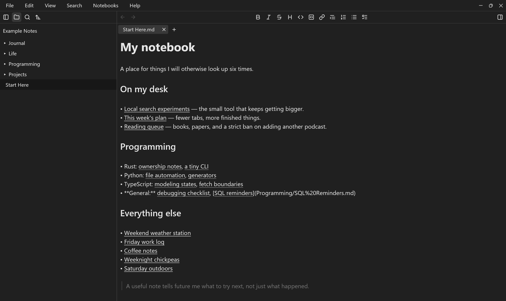
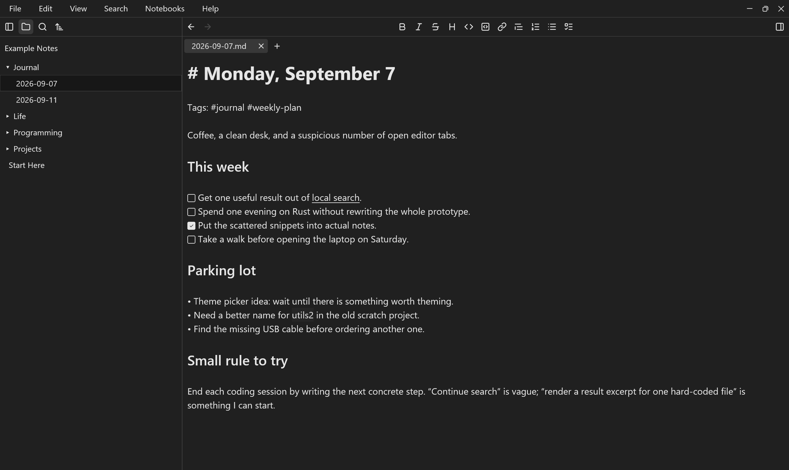
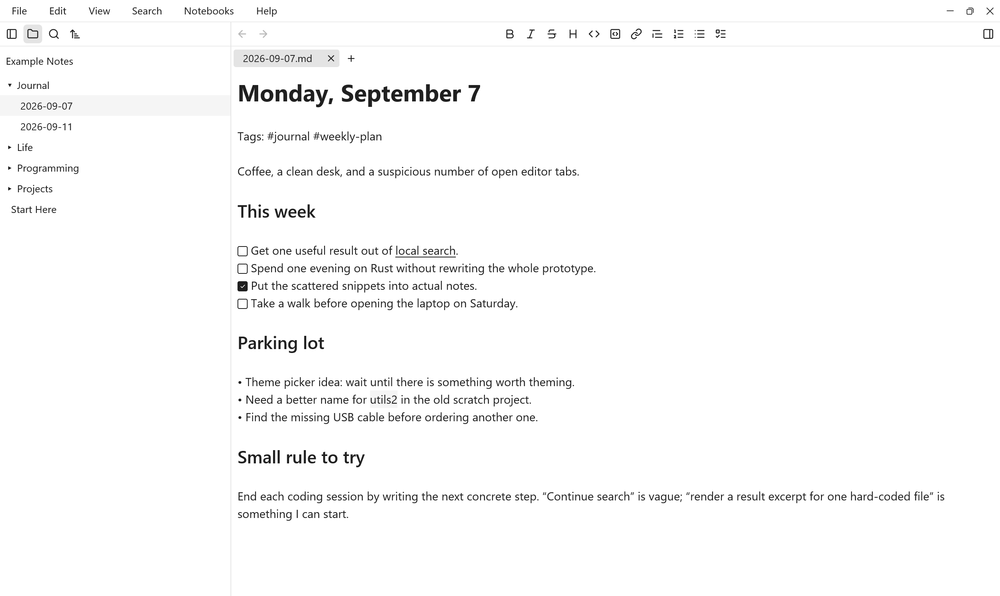
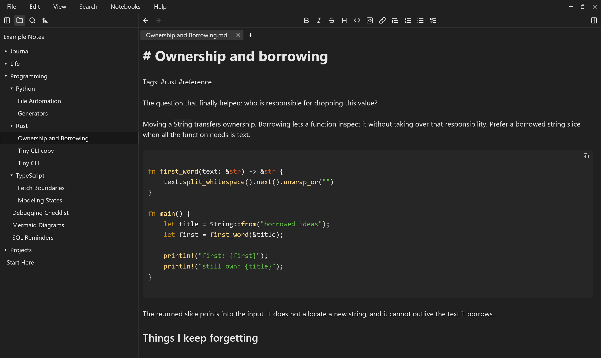
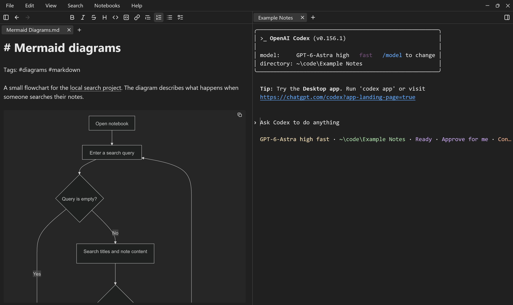

# Markdown Note

A free, open-source desktop app for notes, journals, and documentation in
Markdown. Your notes stay ordinary text files in folders you choose.



## Make yourself at home

- **Write your way.** Switch between Markdown source, editable Live preview, and Reading view.
- **Keep notes together.** Organize folders in notebooks, open document tabs, and search across your notes.
- **Add more than paragraphs.** Use checklists, tables, images, highlighted code, and offline Mermaid diagrams.
- **Set up your workspace.** Choose light or dark colors, fonts, a centered editor, and an optional terminal panel.
- **Keep your files.** Notes live on your computer and remain usable in other Markdown editors. Writing and reading work offline; no account is required.

## Get started

**Packaged downloads have not been published for Markdown Note yet.** Windows is
the primary platform; see [Build from source](#build-from-source-windows) below.

Once the app is running:

1. Open **Notebooks → Manage notebooks** and create a notebook or choose **Open folder as notebook** for an existing notes folder.
2. Choose **File → New note** or press **Ctrl+N**. Give the note a name using the file's sidebar context menu.
3. Start writing in Live preview. Use **View** to switch to Source or Reading.
4. Press **Ctrl+O** to find a note, or **Ctrl+Shift+F** to search its contents across the notebook.

Notebook notes autosave by default; **Ctrl+S** saves immediately. Files outside
the active notebook have a separate autosave switch, off by default. You can
also use **File → Open…** without creating a notebook.

See the [user guide](docs/guide.md) for tabs, saving, settings, and supported files.

## Useful shortcuts

| Windows / Linux | Action |
| --- | --- |
| Ctrl+N | Create a note in the active notebook. |
| Ctrl+T / Ctrl+W | Open an empty tab / close the current tab. |
| Ctrl+O | Find a notebook note; open the file picker without a notebook. |
| Ctrl+P | Open the command palette. |
| Ctrl+S | Save the current file. |
| Ctrl+F / Ctrl+Shift+F | Find in the current file / search the notebook. |
| Ctrl+Shift+M | Cycle Source, Live preview, and Reading. |

On macOS, use **Command** instead of **Ctrl** for these shortcuts.
**Help → Keyboard shortcuts** shows the full list for your platform.

## More screenshots

<details>
<summary>Weekly planning, themes, code notes, and the terminal</summary>

**Plan a week with checklists and links.**



**Use a light workspace.**



**Keep code examples beside your explanations.**



**View diagrams alongside a shell.** The optional terminal runs tools you install separately.



</details>

Screenshots show example notebooks; details may vary by version.

## Build from source (Windows)

Install Git, Rust through rustup, Visual Studio C++ Build Tools, and a Windows
SDK. Use the Windows MSVC toolchain. The repository selects Rust 1.98.1 through
[rust-toolchain.toml](rust-toolchain.toml).

In Git Bash, from the repository root:

```bash
cargo build --locked --release
./target/release/markdown-note.exe
```

The desktop build includes the required assets and vendored components. It does
not need a website checkout, Node.js, a database, or a backend service. Linux and
macOS source support exists, but this project does not currently provide packaged
downloads for those platforms.

## Help and contribute

- [User guide](docs/guide.md)
- [Mermaid diagrams](docs/mermaid.md) and [terminal guide](docs/terminal.md)
- [Report a bug or suggest an improvement](https://github.com/travisluong/markdown-note/issues)
- [Contributing and development checks](CONTRIBUTING.md)

The optional **Help → Send feedback…** form uses an existing hosted service.
See [what it sends](docs/feedback.md); the service is not required to use your notes.

## License

Markdown Note is available under the [MIT License](LICENSE). Vendored components
and third-party assets retain their own licenses and notices.
