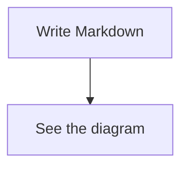

# Mermaid diagrams

Label a fenced code block `mermaid`:

````markdown

````

Live preview and Reading render the diagram automatically. In Live preview,
click the diagram or move the caret/selection into its block to edit its source.
Move outside the block to see the updated diagram. Source mode always shows the
Markdown. Copy code copies the Mermaid body without fences. An active Find match
inside a diagram reveals its source, including in Reading.

Backtick and tilde fences work, including fences nested in lists or blockquotes.
The language label is case-insensitive. Diagrams fit the available width and use
a light or dark theme matching the application. Loading and invalid diagrams
show source with a short status/error message; the Markdown is never replaced
with an image on disk.

Rendering is offline using Merman 0.7.0. Supported syntax is the built-in syntax
implemented by that native renderer, with differences from Mermaid.js in some
layouts, fonts and less common features. Flowchart, sequence, class, state, ER,
Gantt and pie diagrams have application regression coverage. No browser, Node.js
installation or network service is needed. External image resources, diagram
links, export and zoom/pan controls are not supported. Diagram source is limited
to 50,000 UTF-8 bytes and the rendered image to 4 megapixels at the current display
scale; larger diagrams show a limit message with their source.

Sequence participant names may contain spaces, including implicit participants
such as `blue node->>green worker: Hello`. Markdown Note includes a local parser fix
for these names; existing diagrams do not need to be rewritten with aliases.
